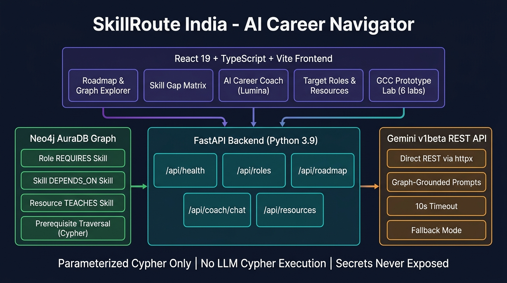
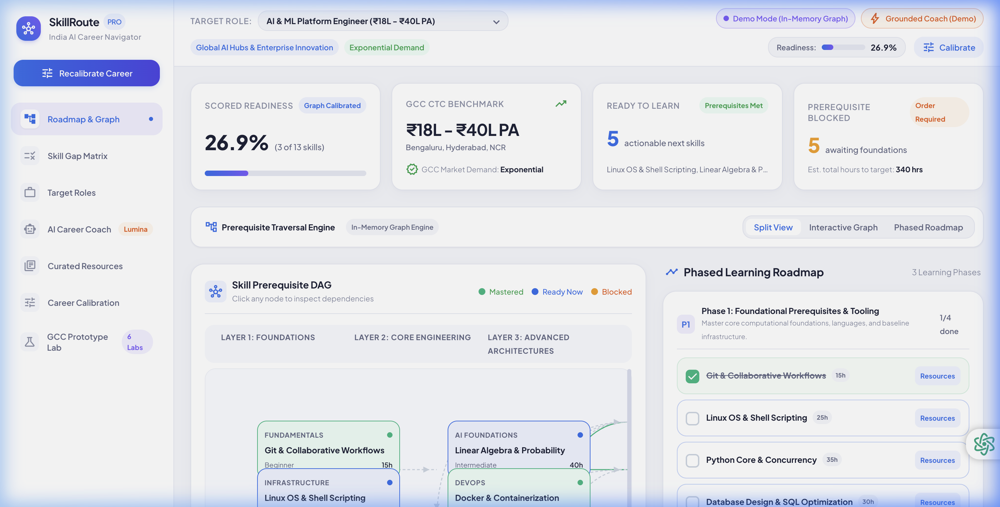
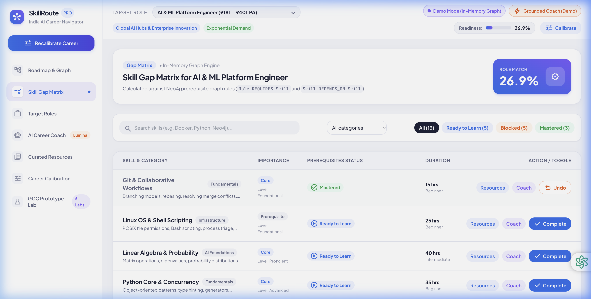
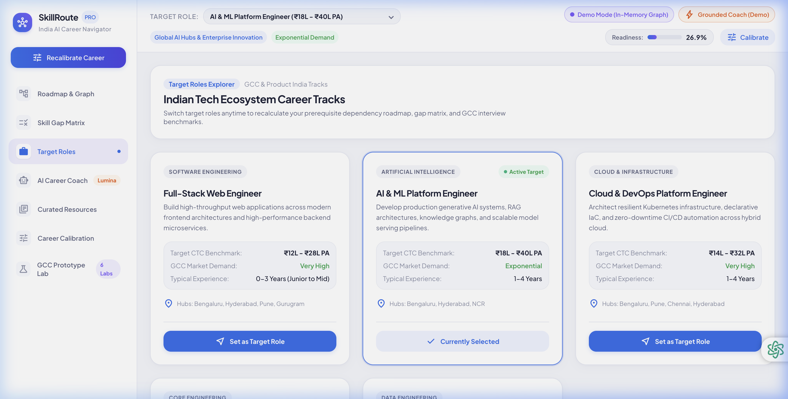
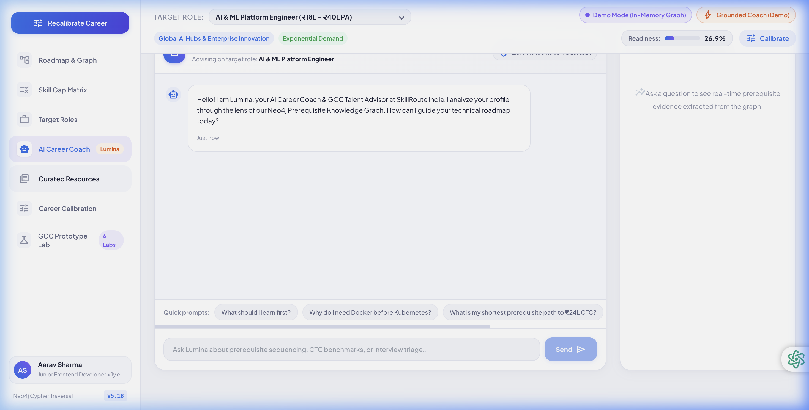
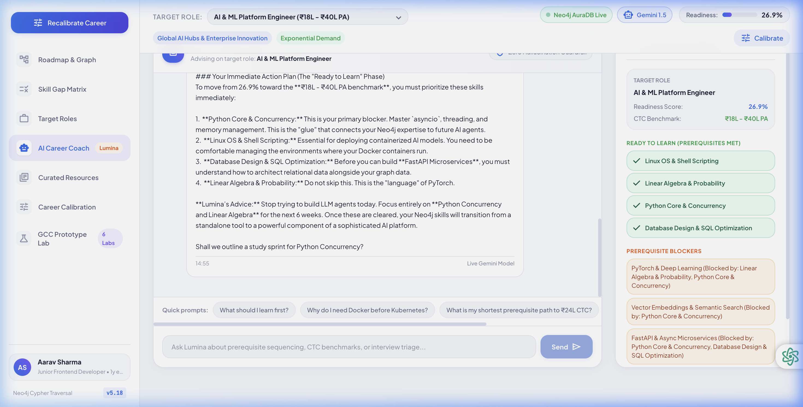
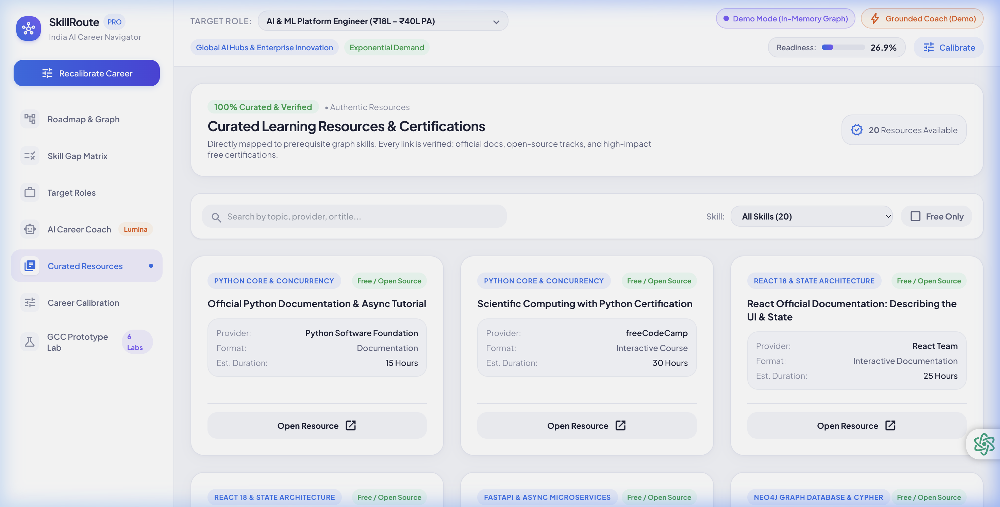
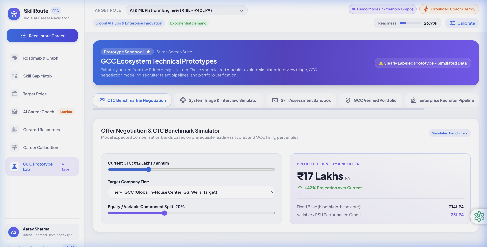

<div align="center">

# SkillRoute India 🚀
### AI-Powered Career Navigator & Prerequisite Graph Engine
**Tailored for India's GCC & Product Tech Ecosystem**

[](https://www.python.org/)
[](https://fastapi.tiangolo.com/)
[](https://react.dev/)
[](https://www.typescriptlang.org/)
[](https://neo4j.com/cloud/platform/aura-graph-database/)
[](https://ai.google.dev/)
[](https://vitejs.dev/)
[](https://tailwindcss.com/)

*Graph-powered skill gap analysis · Dependency-ordered learning roadmaps · AI career coaching grounded in real graph evidence*

</div>

---

## 🏗️ System Architecture & Workflow

> The complete data flow: from Neo4j AuraDB graph traversal through FastAPI to the React frontend and Gemini AI coaching layer.



### How It Works

```
User → React Frontend → FastAPI Backend → Neo4j AuraDB (Graph DB)
                              ↕
                       Gemini v1beta REST
                    (Graph-Grounded Prompts)
```

1. **Graph Seeding** — 5 Roles, 26 Skills, 36 Dependencies, 48 Role Requirements, 20 Curated Resources seeded via `python -m backend.seed_cli --force`. Never on page load.
2. **Skill Gap Analysis** — Cypher traversal computes `REQUIRES`, `DEPENDS_ON`, and `TEACHES` relationships to score readiness and surface unblocked skills.
3. **Roadmap Generation** — Topological sort of prerequisite graph produces dependency-ordered learning phases.
4. **AI Coaching** — Gemini receives graph evidence (readiness score, blocked/ready skills, CTC benchmarks) as grounded system context before answering.
5. **Frontend Rendering** — React renders the SVG dependency DAG, progress toggles, and live Lumina chat — all updating in real time.

---

## 📸 Application Screenshots

### 🗺️ Roadmap & Dependency Graph Explorer
> Interactive SVG prerequisite DAG visualizing your skill dependency layers. Nodes highlight mastered, ready, and blocked states.



---

### 📊 Skill Gap Matrix
> Scored gap analysis comparing your current skills against role requirements. Shows readiness %, mastered skills, skills ready to learn, and prerequisite blockers.



---

### 🎯 Target Roles Explorer
> Browse 5 curated Indian GCC & product tech career tracks with market demand ratings, CTC benchmarks (₹LPA), and hub focus cities.



---

### 🤖 Lumina — AI Career Coach
> Powered by live Gemini REST API. Every response is grounded in prerequisite graph evidence — never hallucinated. Knows your exact readiness score, blocked skills, and CTC trajectory.



**Live coaching conversation sample:**



---

### 📚 Curated Learning Resources
> 20 verified learning resources (official docs, free certifications, open-source courses) mapped to skills via `(:Resource)-[:TEACHES]->(:Skill)` relationships in the graph.



---

### 🧪 GCC Prototype Labs
> Six specialized innovation labs for advanced career scenarios. Clearly labeled as prototypes — not live recruitment or verified data.



| Lab | Description |
|-----|-------------|
| 🏆 CTC Benchmark Simulator | Offer negotiation & salary benchmarks for Indian tech hubs |
| 🎯 Interview Triage Simulator | System design & DSA mock interview grader |
| 🔬 Skill Assessment Sandbox | Interactive competency self-assessment |
| 📋 GCC Verified Portfolio | Structured portfolio builder for GCC hiring |
| 🏢 Enterprise Recruiter Pipeline | Talent pipeline dashboard concept |
| 💬 AI Mentorship Hub | Peer mentor matching concept |

---

## ⚡ Quick Start

> **Requirements:** Node 20+ and Python 3.9+

```sh
# Clone the repository
git clone https://github.com/nitish11930/skill-route-india-.git
cd skill-route-india-

# Configure environment
cp .env.example .env
# Edit .env and fill in your Neo4j AuraDB and Gemini API credentials

# Run everything with one command
./start.sh
```

Open **http://127.0.0.1:5173** — keep the terminal open, stop with `Ctrl+C`.

**Single-process preview (frontend + API on same port):**
```sh
./start.sh --preview
# Opens at http://127.0.0.1:8001
```

---

## 🔧 Manual Setup

### Backend

```sh
cd backend
python -m venv .venv
source .venv/bin/activate  # Windows: .venv\Scripts\activate
pip install -r requirements.txt

# Seed Neo4j AuraDB (explicit, one-time, idempotent)
cd ..
python -m backend.seed_cli --force

# Start API server
PYTHONPATH=. uvicorn backend.app.main:app --host 127.0.0.1 --port 8000 --reload
```

### Frontend

```sh
npm install --prefix frontend
npm run dev --prefix frontend
```

### Run Tests

```sh
PYTHONPATH=. ./backend/.venv/bin/pytest backend/tests/ -v
# 20 passed in 0.32s
```

---

## 🌐 Environment Variables

Copy `.env.example` to `.env` and fill in:

| Variable | Description | Required |
|----------|-------------|----------|
| `NEO4J_URI` | Neo4j AuraDB connection URI (`neo4j+s://...`) | For live mode |
| `NEO4J_USERNAME` | Neo4j username | For live mode |
| `NEO4J_PASSWORD` | Neo4j password | For live mode |
| `NEO4J_DATABASE` | Database name (usually `neo4j`) | For live mode |
| `GEMINI_API_KEY` | Google Gemini API key | For live AI coaching |
| `GEMINI_MODEL` | Model name e.g. `gemini-3.1-flash-lite` | For live AI coaching |

> **Demo Mode:** Leave any credential blank and the app runs transparently with an in-memory graph fallback. The header clearly displays `Demo Mode` status. No fake data, no false claims.

---

## 🗄️ Neo4j Graph Schema

```cypher
// Nodes
(:Role    {id, title, category, summary, marketDemand, typicalExperience, tier})
(:Skill   {id, name, category, description, estimatedHours, difficulty})
(:Resource{id, title, url, provider, type, is_free, duration, rating})

// Relationships
(:Role)-[:REQUIRES {importance, level}]->(:Skill)
(:Skill)-[:DEPENDS_ON {strictness}]->(:Skill)   // Prerequisite edge: B before A
(:Resource)-[:TEACHES {level}]->(:Skill)
```

**Seeded data:**
- **5 Roles** — Full-Stack SWE, AI/ML Platform Engineer, Cloud/DevOps, Data Engineering, Android
- **26 Skills** — Across Foundations, Core Engineering, and Advanced Architecture layers
- **36 Dependency edges** — Prerequisite graph traversal enabled
- **48 Role requirements** — Core, Recommended, Elective importance tiers
- **20 Curated resources** — Official docs, free certifications, open-source tracks

---

## 🛡️ Security & Engineering Principles

| Principle | Implementation |
|-----------|---------------|
| **Parameterized Cypher only** | Zero string concatenation with user input in Cypher queries |
| **No LLM-generated Cypher** | Gemini operates in advisory role only; graph is queried by backend services |
| **No silent DB seeding** | `seed_cli` must be invoked explicitly; never runs on page load |
| **Secrets never exposed** | `NEO4J_PASSWORD` and `GEMINI_API_KEY` masked in all API responses and logs |
| **Honest Demo Mode** | `isDemoMode: true` clearly surfaced when credentials absent; never fakes live data |
| **Python 3.9 compatible** | Direct Gemini REST via `httpx` — no deprecated `google-generativeai` SDK |

---

## 📁 Project Structure

```
skill-route-india/
├── backend/
│   ├── app/
│   │   ├── config.py              # Settings loader (pydantic-settings)
│   │   ├── main.py                # FastAPI app, CORS, lifespan
│   │   ├── db/
│   │   │   ├── neo4j_client.py    # AuraDB session handling
│   │   │   ├── memory_store.py    # In-memory demo fallback graph
│   │   │   └── seed_data.py       # Seed definitions (5 roles, 26 skills...)
│   │   ├── routes/                # health, roles, skills, roadmap, resources, coach, user
│   │   └── services/
│   │       ├── graph_service.py   # Skill gap, roadmap, topo-sort
│   │       ├── gemini_service.py  # Direct REST AI coach (grounded)
│   │       └── user_service.py    # Persistent user profile
│   ├── tests/                     # 20 pytest tests (0.32s)
│   ├── seed_cli.py                # Explicit idempotent seed CLI
│   └── requirements.txt
├── frontend/
│   └── src/
│       ├── views/                 # All 7 main views (+ 6 prototype labs)
│       ├── components/            # Header, Sidebar
│       ├── services/api.ts        # Typed API client
│       └── types/index.ts         # Shared TypeScript types
├── stitch_skillroute_india_ai_career_navigator/
│   └── [13 preserved Stitch screens + DESIGN.md]
├── docs/screenshots/              # Architecture & UI screenshots
├── .env.example                   # Safe credential template
├── AGENTS.md                      # Engineering guidelines & guardrails
├── BRAIN.md                       # Project knowledge base
└── start.sh                       # One-command launcher
```

---

## ⚠️ Honest Status

> **Hackathon Neo4j rubric:** Exact hackathon Neo4j product rubric requirements are **PENDING from user, never officially verified**. This project implements genuine Neo4j AuraDB property graph traversal with parameterized Cypher, prerequisite path traversal, constraints, and an explicit seed CLI — but no rubric criteria have been confirmed to the team.

> **Prototype labs:** The 6 GCC Prototype Labs are UI concept explorations only. They do not represent live recruitment, verified mentor profiles, real salary guarantees, or validated credentials.

> **Salary/demand figures:** CTC benchmarks and market demand labels are sample estimates for demonstration purposes.

---

## 🤝 Built With

| Technology | Role |
|-----------|------|
| [Neo4j AuraDB](https://neo4j.com/cloud/platform/aura-graph-database/) | Property graph database (cloud-hosted) |
| [FastAPI](https://fastapi.tiangolo.com/) | Python async REST API framework |
| [React 19](https://react.dev/) + [Vite](https://vitejs.dev/) | Frontend framework + build tool |
| [TypeScript](https://www.typescriptlang.org/) | Type-safe frontend |
| [Tailwind CSS](https://tailwindcss.com/) | Utility-first styling |
| [Google Gemini API](https://ai.google.dev/) | Generative AI coaching (v1beta REST) |
| [httpx](https://www.python-httpx.org/) | Async HTTP client for Gemini REST |
| [Plus Jakarta Sans](https://fonts.google.com/specimen/Plus+Jakarta+Sans) | UI typography |
| [Pydantic v2](https://docs.pydantic.dev/) | Data validation & settings |

---

<div align="center">

**Made with ❤️ for India's tech talent ecosystem**

*SkillRoute India — Helping engineers navigate the GCC & product tech landscape with AI-powered, graph-driven career intelligence.*

</div>
